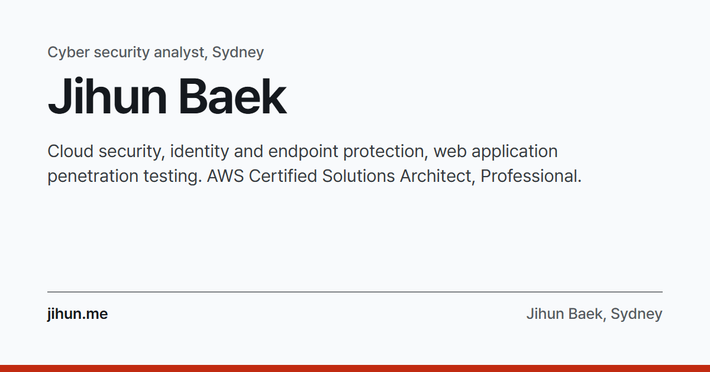

# jihun.me

Source for **[jihun.me](https://jihun.me)**, the portfolio of Jihun Baek, a cyber security analyst in Sydney.

The site presents five projects as engineering case studies: a web security SaaS, a hardened AWS migration of a live business directory, a full penetration test report, an ML attack classifier and a university CTF. It is a static site with no build step and no framework.



## Pages

| Route | What it is |
| --- | --- |
| [`/`](https://jihun.me/) | Selected work, experience, capabilities, credentials and contact |
| [`/cybershield.html`](https://jihun.me/cybershield.html) | CyberShield case study: architecture, scan engine, tiers, bugs resolved, roadmap |
| [`/pentest-report.html`](https://jihun.me/pentest-report.html) | Penetration test report: 11 findings with CVSS, proof of concept and patch |
| [`/ai-attack-classifier.html`](https://jihun.me/ai-attack-classifier.html) | ML write-up: dataset, features, results and known limitations |

The `_posts/` folder holds older Jekyll posts rendered by the Minimal Mistakes remote theme. The four pages above carry no front matter, so Jekyll serves them as written.

## Stack

- Hand-written HTML and CSS, one small script (`assets/js/site.js`, about 60 lines) for the mobile menu and the light/dark switch
- [Pretendard Variable](https://github.com/orioncactus/pretendard) as the only text face, self-hosted as a dynamic unicode-range subset that covers Latin and Korean
- [Geist Mono](https://vercel.com/font) for code and identifiers, self-hosted
- Inline SVG architecture diagrams that share the site's colour tokens
- GitHub Pages with a custom domain (`CNAME`)

## Design

The idea is that the portfolio reads like a security report about my own work: each project is a scoped engagement showing what was built, what was found and what is still open. The full system (tokens, type, layout, controls, motion and the anti-AI rules the site follows) is in [`design.md`](design.md).

- Cool neutral surfaces with one vermillion accent, used for open findings and the primary action
- Light and dark modes from one token set, following the OS until the visitor chooses
- Tables, definition lists and ledgers instead of cards; no gradients, glows, badges or terminal costume
- Visible focus states, `prefers-reduced-motion` support, and content that renders without JavaScript

## Structure

```text
.
├── index.html                  Homepage
├── cybershield.html            Case study
├── pentest-report.html         Penetration test report
├── ai-attack-classifier.html   ML write-up
├── design.md                   Design system and rules
├── sitemap.xml, robots.txt
├── CNAME                       jihun.me
├── _config.yml, _posts/        Legacy Jekyll posts
└── assets/
    ├── css/        tokens.css (all colours and faces), base.css, fonts.css, site.css
    ├── js/         site.js
    ├── fonts/      pretendard/ (subset CSS + 92 WOFF2 files), geist-mono/
    ├── images/     portrait, project screenshots (work/), social cards (og/), favicon
    └── Jihun_Baek_Resume.pdf
```

## Run locally

No install is needed. Serve the folder over HTTP so the fonts load:

```bash
python -m http.server 8000
# open http://localhost:8000
```

To preview the Jekyll posts as GitHub Pages builds them, use Jekyll instead (`bundle exec jekyll serve` with the `github-pages` gem).

## Build and deploy

There is no build step. Pushing to `main` publishes the site through GitHub Pages, which serves it at the custom domain in `CNAME`.

Before pushing a design change, run the Hallmark linter against the local server:

```bash
node <hallmark>/scripts/sloplint.mjs index.html cybershield.html pentest-report.html ai-attack-classifier.html assets/css \
  --genre modern-minimal --render --url http://localhost:8000/
```

## Licence

The fonts are under the SIL Open Font License 1.1; their licence files sit beside them in `assets/fonts/`. The content and screenshots are © Jihun Baek.
